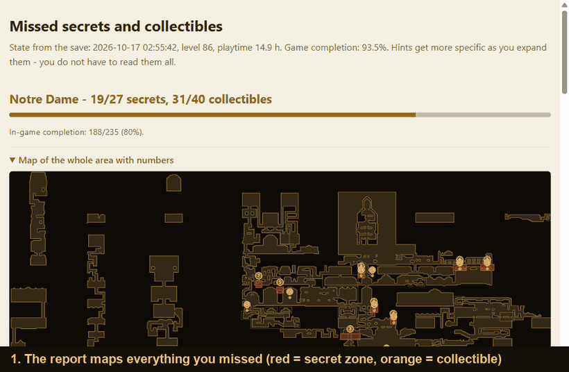
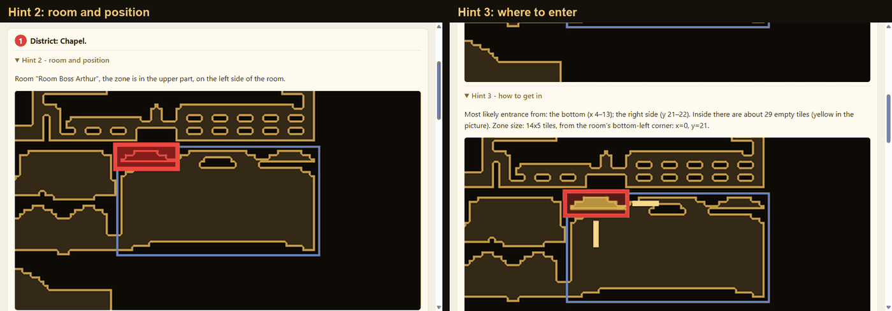
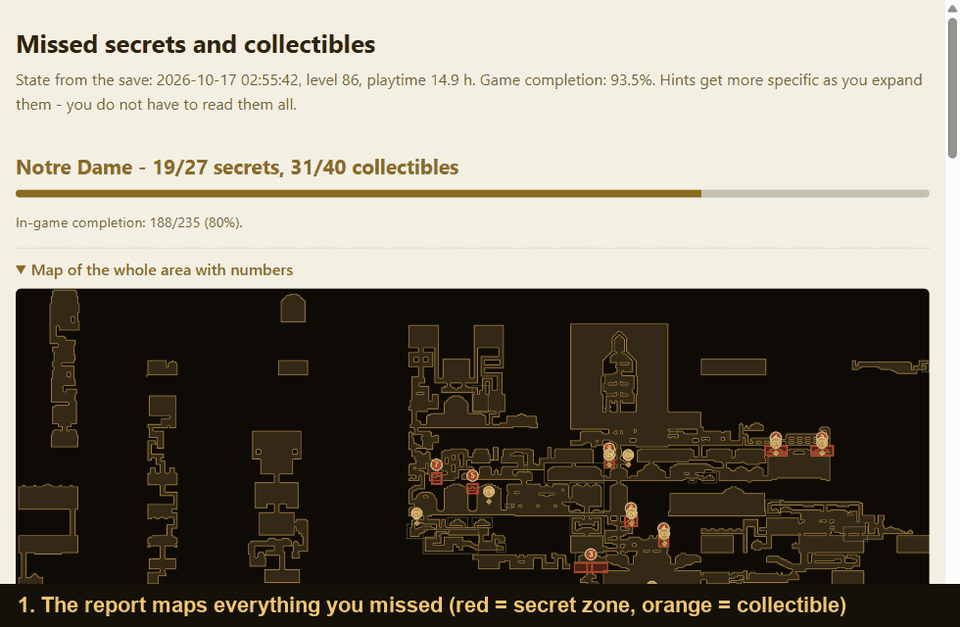
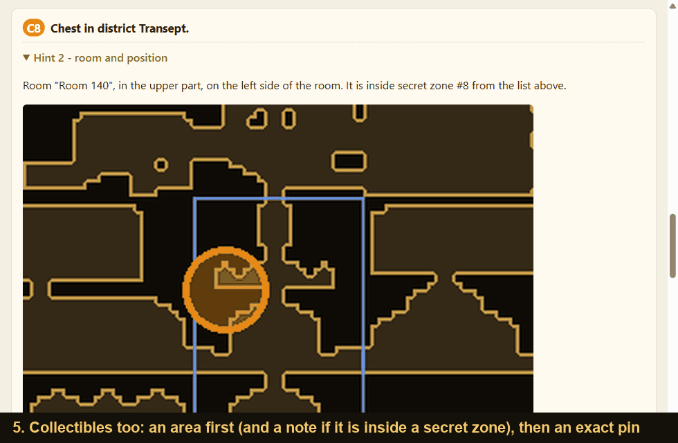

<h1 align="center">Castlevania: Belmont's Curse – missed secrets &amp; collectibles finder</h1>

<p align="center">
  <b>Read your save file, find out what you missed, and get hints that don't spoil more than you want.</b>
</p>

<p align="center">
  <a href="https://github.com/PikselYT/belmonts-curse-secret-hints/releases/latest"></a>
  <a href="LICENSE"></a>
  
  
  
</p>

<p align="center">
  
</p>

## What it does
Completionist runs get stuck on the last few secret zones and chests. This tool opens your newest save
(read-only – it never modifies the game or your save), compares it with data extracted from your own game
install and writes a single `report.html` listing everything you missed:

* **Secret zones** – the hidden rooms and passages.
* **Collectibles** – chests, health and mana upgrades, attack and defense books, experience sources.

Every item comes with **three hints that you expand one at a time**, so you decide how much to spoil:

1. the **district** only,
2. the **room** and the position inside it (with a picture),
3. the **exact spot** or **where to enter from**.

<p align="center">
  
</p>

Hints unlock once the game's own completion counter reaches a threshold (default 90%), so the tool doesn't
spoil the early game. Use `--force` to see them anyway.

<table>
  <tr>
    <td width="50%"><br><sub>Overview map: red = secret zones, orange = collectibles.</sub></td>
    <td width="50%"><br><sub>A chest that sits inside a secret zone you haven't found.</sub></td>
  </tr>
</table>

> The maps are schematic outlines drawn from the room collision data of your own install – no game art is
> included in this repository or in the report.

## Quick start (Windows)
1. Install Python 3.9+ from [python.org](https://www.python.org/downloads/) (keep the `py` launcher or add Python to PATH).
2. Run **`setup.bat`** – creates a local `.venv` and installs `requirements.txt`.
3. Run **`run_extract.bat`** – extracts the game data into `data/` (about a minute the first time, ~15 s afterwards).
   Repeat after every game update – the tool warns you when the data is out of date.
4. Run **`run_hints.bat`** – generates and opens `report.html`.

The game install and the save folder are auto-detected (Steam registry + `libraryfolders.vdf`, best effort for
Linux/Proton). To override, pass `--game` / `--save`, set `BC_GAME_DIR` / `BC_SAVE_DIR`, or copy
`config.example.json` to `config.json`.

## Options (`hints.py`, also via `run_hints.bat`)
| option | meaning |
|---|---|
| `--min-progress 90` | in-game completion (%) needed to unlock hints (default 90) |
| `--force` | ignore the threshold |
| `--items chest,health,mana,atk_book,def_book,xp` | collectible kinds to track (default: all); `none` = secret zones only |
| `--level 1\|2\|3` | how much detail is printed in the console (the HTML report always has all three) |
| `--biome MainHall` | one area only (written to `report_MainHall.html`) |
| `--save <file>` | a specific save instead of the newest `BuildSave_*.sav` |
| `--json missing.json` | machine-readable list of everything missing |

## How it works
* The "game completion" threshold uses the game's own counter: `worldSaves[...].currentCompletionItemCount`
  divided by `totalCompletionCount` from the game's `CompletionAggregator`, summed over all worlds.
  If that data is missing, the tool falls back to the share of fully explored map chunks.
* A secret zone counts as found if its index is in
  `worldRoomExplorationStates[<world>_<room>].discoveredSecretZones`.
  "Resettable" zones are never recorded as discovered by the game, so they are not counted.
* Collectibles are matched through the scene's `_savableIDs` (entity GUID → object name and position). The game stores
  `{"activated": true}` in `worldSaves[...].savableEntityStates` for every chest opened / item taken / source destroyed.
  The collected totals match the game's own per-room counters in every area, which is how the matching was verified.
* When a collectible lies inside a missing secret zone, the hint says so.
* A room's scene origin is `(cx + offX)·24, (cy + offY)·13` tiles (`editionOffsetCoord` from the room data).
* The "entrance" hint is a heuristic from the collision grid: which edges of the zone touch open space.
  Positions can be off by 1–2 tiles.
* The game only writes the save at save points, so the report shows the state of the last save.

## Known limitations
* Chests, upgrades, books and experience sources only – not weapons dropped by enemies, relics, tarot cards or boss rewards.
  The report shows how many completion items are still missing per area.
* A room you have not visited yet is flagged in the hint ("you have not visited this room yet").
* Verified in game for Main Hall secret zones (Boudoirs, Ballrooms, Dungeon); everything else uses the same method.
* The game data in `data/` is generated locally from your install and is not part of this repository.

## Layout
```
extract_data.py   extracts rooms, collisions, zones, collectibles, district names and completion totals (UnityPy)
hints.py          reads the save, finds what is missing, draws maps and the HTML report
paths.py          finds the game install and save folder
setup.bat         creates .venv and installs dependencies
run_extract.bat / run_hints.bat   run the scripts from .venv
docs/             images used in this README
```

MIT licensed (see `LICENSE`). Not affiliated with Konami or the game's developers.
